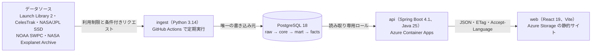

# 星空 Hoshizora

[English](README.md)

**公開サイト：<https://hoshizorapreview.z48.web.core.windows.net/ja>**（[English](https://hoshizorapreview.z48.web.core.windows.net/en)）

> API は無料枠で動いており、アクセスがないときは停止しています。最初の表示では起動に1分ほどかかることがあります。その間もページは使え、データ接続を準備中であることを表示します。


星空は、英語と日本語に対応した宇宙データの分析プラットフォームです。5つの公開データソースから形式のばらばらなデータを集め、一つのリレーショナルモデルに正規化し、PostgreSQL で集計して、データに基づく豆知識として英語と日本語で紹介します。サイトに表示するすべての数値は、元の記録までたどれます。

| | |
|---|---|
| データソース | Launch Library 2、CelesTrak、NASA/JPL Solar System Dynamics、NOAA SWPC、NASA Exoplanet Archive の5つ |
| データベース | PostgreSQL 18。スキーマは `raw`、`core`、`mart`、`facts` の4つ。Flyway のマイグレーション21件、マテリアライズドビューのマート15個 |
| API | `/api/v1` 以下の読み取り専用ルート29本。OpenAPI 3.1、`Accept-Language` に応じて英語または日本語で応答 |
| 豆知識 | 8分野・40件の SQL テンプレート。すべてにテストがあり、英語と日本語で表示 |
| 組織データ | 出典付きの日本語名を持つ117の組織を、10の国別プログラムにまとめて整理 |
| テスト | CI で541件：取り込み198件（pytest、Testcontainers）、API 229件（JUnit、Testcontainers、OpenAPI 照合）、Web の単体テスト70件（Vitest）、ブラウザテスト44件（Playwright、英日・PC とスマートフォン） |
| Lighthouse | 公開サイトで2026年10月24日に各ページ1回計測：アクセシビリティは全9ページで100、パフォーマンスはデスクトップ90〜98、モバイル50〜76（制限事項を参照）。2026年10月18日にローカルの本番ビルドで計測したモバイルは89〜97 |

## 見どころ

- **書き込み元は一つだけ**：データを書き込むのは Python の取り込み処理だけで、API は読み取り専用のロールで接続します。スキーマは Flyway が管理し、取り込み用のロールは DDL を実行できません。
- **中断しても再開できる取り込み**：すべての応答を、内容のハッシュ付きで追記専用の raw 層に保存します。取得済みの範囲や ETag などの情報はここから導くため、どこで止まっても次の実行で続きから再開できます。データソースごとに利用制限を守り（Launch Library 2 は1時間に15リクエスト）、待ち時間が長すぎる場合は無理に待たず `partial` として終了します。
- **不揃いなデータの整理**：打ち上げ事業者は宇宙機関と同じではなく、CelesTrak の所有者コードは組織ではなく国を表します。組織、別名、国、国別プログラムを整理し、たとえば「日本の打ち上げ」には宇宙航空研究開発機構（JAXA）と三菱重工業の打ち上げをまとめて数えます。対応づけのないコードはデータ品質チェックで検出し、黙って捨てることはありません。
- **出典をたどれる設計**：core 層の各行は元になった raw の記録を持ち、豆知識はその根拠となる行を保存します。画面の「根拠となるデータ」から、数値の元の記録を確認できます。
- **計算で作る豆知識**：テンプレートは SQL と英語・日本語の文で構成します。候補を珍しさや記録性で採点し、保存するのは文章ではなくパラメーターだけです。文は API がリクエストごとに組み立てます（例：「東京スカイツリーの高さの9.9倍」）。
- **テストで守る API 仕様**：エンドポイントのテストはすべての応答を `openapi.yaml` と照合し、仕様とコードがずれるとテストが失敗します。仕様から生成する TypeScript の型が最新であることも CI で確認しています。
- **日本語を最初から**：`/en/…` と `/ja/…` のパスで言語を切り替え、数値や日付は `Intl` で表示します（万・億、2026年10月19日）。時刻は日本時間でも表示し、片方の言語にしかない UI 文言があるとテストが失敗します。


ページ：ホーム、打ち上げ（国別の推移、成功率、発射台、ブースターの再使用と着陸）、地球近傍天体（接近、大きさと距離、衝突リスク）、太陽（フレア、Kp 指数、太陽風、オーロラ予報）、系外惑星（発見数、大きさと公転周期、近い惑星）、宇宙機関（組織ごとの紹介）、出典とクレジット。

## 構成



主な技術：Python（httpx、pydantic、polars、psycopg）、PostgreSQL と Flyway、Java と Spring Boot（JdbcClient、Caffeine、springdoc-openapi）、TypeScript と React（react-three-fiber、ECharts、Tailwind CSS、i18next）。テストには pytest、JUnit と Testcontainers、Vitest、Playwright を使っています。詳しくは英語の [README](README.md)、[アーキテクチャ](docs/architecture.md)、[設計判断の記録](docs/decisions/)をご覧ください。

## ローカルでの実行

Docker、just、uv、Node.js 24（pnpm）、JDK（JDK 25 は Gradle が取得します）が必要です。ローカルでは `.env` は不要で、設定を変えたいときだけ `.env.example` をコピーします。

```bash
just up            # PostgreSQL 18 を Docker で起動
just migrate       # Flyway のマイグレーションとローカル用ログイン
just ingest-all    # 取得、正規化、マート更新、豆知識の生成
just api           # http://localhost:8080/api/v1
just web           # http://localhost:5173
```

`just check` で CI と同じリント、型チェック、全テストを実行します。結合テストは PostgreSQL のコンテナを自動で起動するため、Docker を動かしておいてください。

## 制限事項

- API は無料枠で停止状態から起動するため、最初の応答に1分ほどかかることがあります。データの更新は6時間ごとです。
- Launch Library 2 は1時間に15リクエストまでのため、打ち上げの全履歴の取得には約6時間かかります。取得が途中のデータソースの豆知識は、不完全なデータから計算せずに表示を控えます。
- ロスコスモスと中国国家航天局（CNSA）は一般向けの打ち上げ API を公開していないため、Launch Library 2 と CelesTrak のデータで補っています。
- 公開サイトのモバイルのパフォーマンスは50〜76で、目標の80に届いていません。原因の一つは配信元で、Azure Storage の静的サイトはファイルを圧縮せずに送るため、メインのスクリプトは gzip なら約108KBのところ344KBになります。同じビルドをローカルで配信した場合は89〜97でした。
- API の更新とサイトのアップロードは手作業で行っています（CI はすべての変更をテストします）。

## データとクレジット

打ち上げデータ：The Space Devs（Launch Library 2）。軌道データ：CelesTrak。小天体データ：NASA/JPL Solar System Dynamics。宇宙天気データ：NOAA Space Weather Prediction Center。系外惑星データ：NASA Exoplanet Archive。国名：Unicode CLDR。フォント：M PLUS 1 と IBM Plex Sans JP（SIL Open Font License 1.1）。詳しくは [THIRD_PARTY_NOTICES.md](THIRD_PARTY_NOTICES.md)（英語）をご覧ください。

星空はこれらの組織と提携しておらず、承認も受けていません。各データソースの詳細は [docs/sources/](docs/sources/)（英語）にあります。

## ライセンス

Copyright (c) 2026 Akshat Mishra. All rights reserved. このコードはポートフォリオの審査用として閲覧のみを目的に公開しています。利用、複製、改変、再配布は許可していません（[LICENSE](LICENSE)）。第三者のデータとフォントには、それぞれの条件が適用されます。
