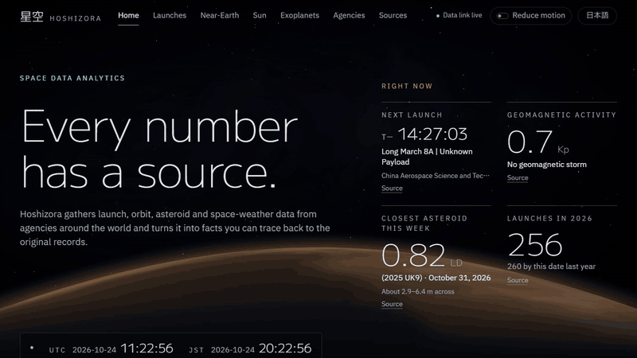
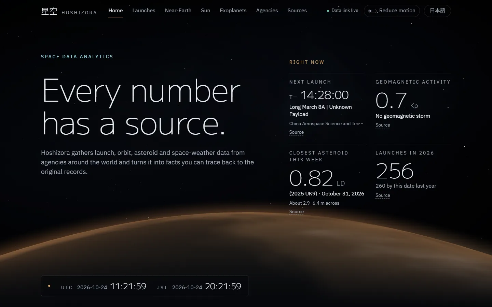
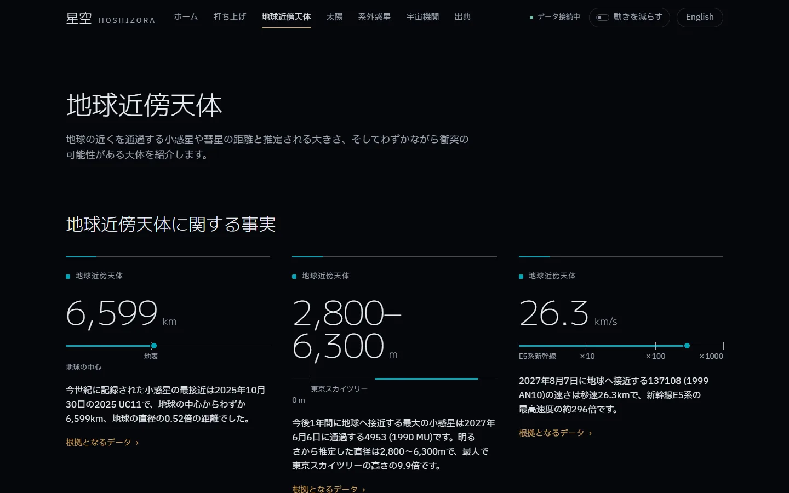
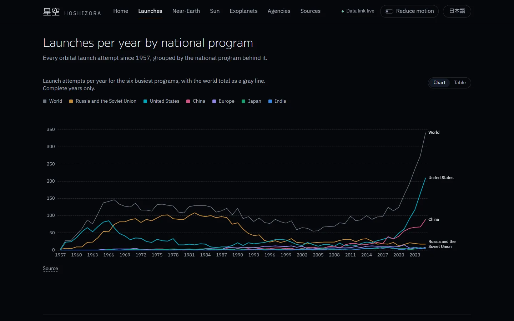
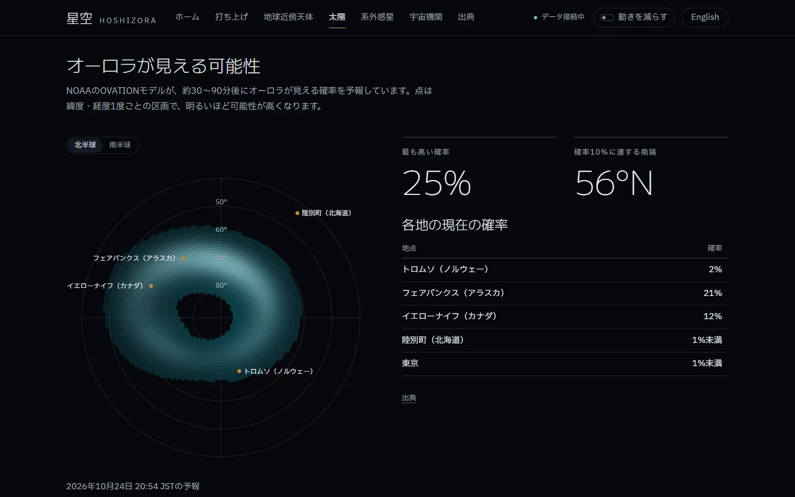
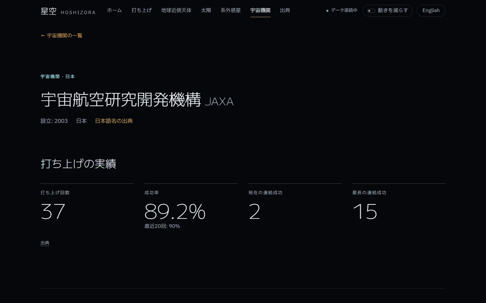
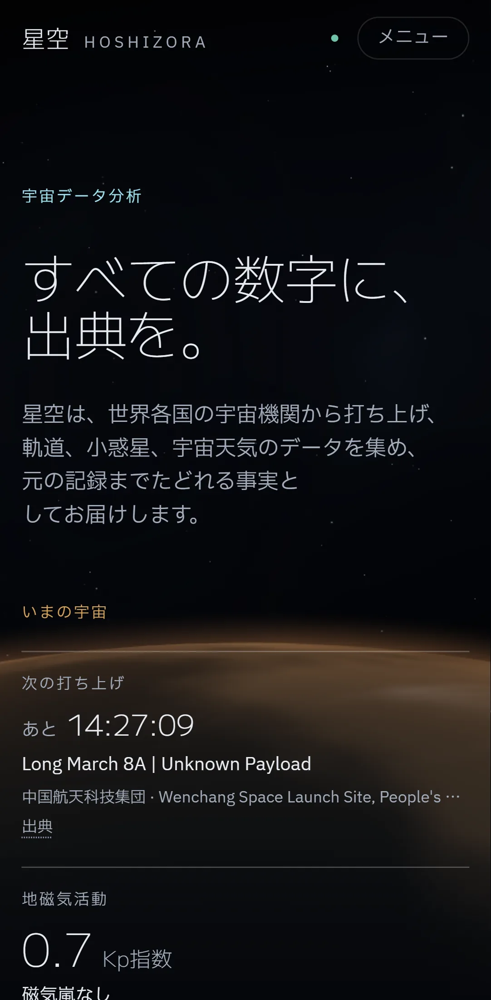
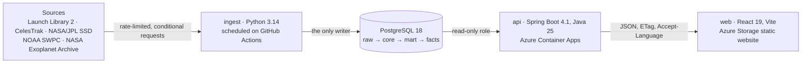

# 星空 Hoshizora

**Bilingual (English / 日本語) space-data analytics platform: Python ingestion, PostgreSQL marts, a read-only Spring Boot API and a React front end**

[](https://github.com/froxily/hoshizora/actions/workflows/ci.yml)

[日本語の README](README.ja.md)

**Live: <https://hoshizorapreview.z48.web.core.windows.net/en>** ([日本語版](https://hoshizorapreview.z48.web.core.windows.net/ja))

> The API runs on a free tier that scales to zero, so the first load can take up to about a minute while it wakes. The page stays usable and says it is waking the data link.



Hoshizora pulls messy, inconsistent data from five public space-data sources, normalizes it into one relational model, computes analytics in PostgreSQL, and turns the results into scored "fun facts" in English and Japanese. Every number on the site links back to the source records it came from.

| | |
|---|---|
| Sources | **5** public APIs: Launch Library 2, CelesTrak, NASA/JPL Solar System Dynamics, NOAA SWPC, NASA Exoplanet Archive |
| Database | PostgreSQL 18 with **4 schemas** (`raw`, `core`, `mart`, `facts`), **21** versioned Flyway migrations, **15** materialized-view marts |
| API | **29** read-only `GET` routes under `/api/v1`, OpenAPI 3.1, English or Japanese per `Accept-Language` |
| Facts | **40** SQL fact templates in 8 modules, each tested, rendered in both languages |
| Curation | **117** organizations with cited Japanese names, grouped into 10 national programs |
| Tests | **541** in CI: 198 ingest (pytest, Testcontainers), 229 API (JUnit, Testcontainers, OpenAPI validation), 70 web unit (Vitest), 44 browser (Playwright, en and ja, desktop and phone) |
| Lighthouse | Live site, 2026-10-24, one run per page: accessibility **100** on all 9 pages, desktop performance **90–98**, mobile performance **50–76** (see [Limitations](#limitations)). A local production build scored 89–97 on mobile on 2026-10-18 |

## Engineering highlights

- **Single-writer data platform.** A Python service is the only writer; the API connects with a PostgreSQL role that can only read. Flyway owns the schema, and the ingest role cannot run DDL ([ADR 0001](docs/decisions/0001-read-write-split.md)).
- **Resumable, polite ingestion.** Every HTTP response lands in an append-only, content-hashed raw zone. Watermarks, refetch intervals and ETag/Last-Modified validators are derived from it, so a run can stop anywhere and the next one resumes. Each source has its own rate limiter (Launch Library 2 allows 15 requests an hour), and a run that would wait too long ends as `partial` instead of hanging ([ADR 0002](docs/decisions/0002-resumable-ingestion.md)).
- **Messy data, modelled honestly.** A launch provider is not a space agency, and a CelesTrak owner code is a country, not an organization. Organizations, aliases, countries and national programs are curated, so "Japan's launches" means JAXA and Mitsubishi Heavy Industries together. Any code that is not mapped fails a data-quality check instead of quietly disappearing ([ADR 0003](docs/decisions/0003-organization-model.md), [organizations](docs/sources/organizations.md)).
- **Lineage end to end.** Each changed core row records the raw payload that produced it, a lineage view joins it to the request that fetched it, and every fact stores the rows behind it. The UI's "How we know this" link shows those records ([ADR 0005](docs/decisions/0005-marts-and-lineage.md)).
- **Facts as data, not prose.** Templates are SQL plus English and Japanese text. Candidates are scored by percentile, records and recency, and the database stores only parameters; the API renders the text per request ("just 0.52× Earth's diameter", 「東京スカイツリーの高さの9.9倍」) ([ADR 0006](docs/decisions/0006-fact-engine.md)).
- **A tested API contract.** Each endpoint test validates its responses against the committed `openapi.yaml`, a test fails when the spec drifts from the code, and CI checks that the TypeScript types generated from the spec are current ([ADR 0004](docs/decisions/0004-api-contract.md)).
- **Japanese as a first-class language.** Locale-prefixed routes (`/en/…`, `/ja/…`) with `hreflang`, `Intl` number and date formatting (万 / 億, 2026年10月19日), JST times, and a test that fails when a UI string exists in one locale but not the other.

## Screenshots

| | |
|---|---|
|  |  |
|  |  |
|  |  |

Pages: Home, Launches (cadence by nation, success rates, busiest pads, booster reuse and landings), Near-Earth (close approaches, size against distance, Sentry impact risk), Sun (flares, Kp, solar wind, aurora forecast), Exoplanets (discoveries, size against orbit, nearest planets), Agencies (a profile for each organization) and Sources & Credits.

## Architecture



Each ingestion run does the same four steps: land raw → upsert core → refresh marts → regenerate facts.

### Ingestion (Python)

- **One protocol per source** (`ingest/hoshizora_ingest/sources/base.py`): `fetch` plans requests through a shared async HTTP context (httpx), `parse` validates payloads into one pydantic v2 model per source shape, and `normalize` is a pure function from payloads to core rows. Upserts are idempotent, so re-running a payload changes nothing.
- **Shared runtime**: per-source rate limits, retry with backoff (tenacity), conditional requests, a request log (`raw.fetch`) and a run log (`raw.ingest_run`). Sources whose policy asks for it, such as CelesTrak, stop on any non-200 and are held as `needs_review` until someone resumes them.
- **Replay**: `just replay <source>` rebuilds a source's core rows from stored raw payloads without a network call. Superseded bodies of the large snapshot feeds are pruned after 48 hours; their rows and lineage stay ([ADR 0009](docs/decisions/0009-scheduled-ingestion-and-raw-retention.md)).
- **Data quality**: `just dq` reports unmapped codes, organizations missing a cited Japanese name, unmatched landings and other gaps; `--strict` fails on blocking problems.

### Data model (PostgreSQL)

| Schema | Holds |
|---|---|
| `raw` | Append-only payloads (`source`, `endpoint`, `params`, `fetched_at`, `content_hash`, compressed `jsonb` body), the request log, the run log, the retention policy |
| `core` | The normalized model: organizations, aliases, countries, programs, launches, vehicles, pads, launchers and landings, catalogued objects and orbital elements, close approaches, impact risk, space-weather events and indices, exoplanets, and `source_record` lineage links |
| `mart` | Materialized views per page, such as `launch_cadence_yearly`, `launch_success_rolling`, `objects_in_orbit_by_country`, `close_approach_monthly`, `reusability_yearly` and `exoplanet_discoveries_yearly`, refreshed after each run that changes rows |
| `facts` | Templates and generated facts: parameters, score, kind, `source_refs`, `valid_until` |

### API (Spring Boot)

- Java 25 and Spring Boot 4.1 with virtual threads, package by feature (`launches`, `agencies`, `neo`, `spaceweather`, `exoplanets`, `stats`, `facts`, `meta`).
- Reads are SQL through `JdbcClient` into Java records; the analytics live in the marts, not in an ORM.
- Caffeine caches with TTLs matched to each source's update cadence (30 minutes for the aurora forecast, 24 hours for exoplanets), `Cache-Control`, ETags with `304 Not Modified`, and gzip.
- RFC 9457 Problem Details for every error, with localized messages; validated paging and filters.
- `Vary: Accept-Language`, so caches never serve English to a Japanese page. CORS is answered by the API for the configured origins only.
- Actuator exposes only `health`. The container runs as a non-root user with an AOT cache for fast starts.

### Web (React)

- React 19, TypeScript 6 (strict), React Router 8, TanStack Query, a client typed from the OpenAPI spec (openapi-typescript), ECharts 6 and Tailwind CSS 4.
- A procedural hero scene (react-three-fiber with custom GLSL starfield, nebula and planet shaders), loaded lazily after the page content, with quality chosen by device and a static fallback without WebGL.
- Accessibility: a table view for every chart, reduced-motion mode (system setting plus a manual toggle) and full keyboard navigation.
- Static hosting with deep links: after the build, a script writes a per-route HTML shell for each page and agency in both languages, with its own `lang`, title, canonical link, `hreflang` and Open Graph tags.

More detail: [docs/architecture.md](docs/architecture.md), the [decision records](docs/decisions/), the [per-source notes](docs/sources/) and [deployment](docs/deploy.md).

## Tech stack

| Part | Built with |
|---|---|
| ingest | Python 3.14, uv, httpx (async), pydantic v2, polars, psycopg 3, tenacity, typer, structlog; pytest, respx, Testcontainers, ruff, pyright (strict) |
| database | PostgreSQL 18, Flyway |
| api | Java 25, Spring Boot 4.1, JdbcClient, Caffeine, springdoc-openapi, Gradle (Kotlin DSL); JUnit 5, Testcontainers, Atlassian OpenAPI validator, Spotless |
| web | TypeScript 6, React 19, Vite 8, React Router 8, TanStack Query 5, react-three-fiber, ECharts 6, Tailwind CSS 4, i18next; Vitest, Playwright, ESLint, Prettier, pnpm |
| delivery | Docker Compose, GitHub Actions, GitHub Container Registry, Azure Container Apps, Azure Storage static website, Neon (managed PostgreSQL) |

## Run it locally

### Prerequisites

- Docker
- [just](https://github.com/casey/just)
- [uv](https://docs.astral.sh/uv/) (it installs Python 3.14)
- Node.js 24 and pnpm
- Any JDK to start Gradle (it downloads JDK 25 itself)

On Windows: `winget install EclipseAdoptium.Temurin.25.JDK astral-sh.uv OpenJS.NodeJS.LTS pnpm.pnpm Casey.Just`.

### Start

```bash
just up            # PostgreSQL 18 in Docker
just migrate       # Flyway migrations and the local login roles
just ingest-all    # land, normalize, refresh marts, generate facts
just backfill      # optional: the full Launch Library 2 history (15 requests an hour, about six hours)
just api           # http://localhost:8080/api/v1, spec at /v3/api-docs
just web           # http://localhost:5173
```

The first `just ingest-all` loads the latest data from every source. Launch Library 2's full history needs `just backfill` because of its hourly limit.

### Configuration

No `.env` is needed locally: every variable has a local default. Copy `.env.example` to `.env` only to override one.

| Variable | Default | Used by |
|---|---|---|
| `POSTGRES_DB`, `POSTGRES_USER`, `POSTGRES_PASSWORD`, `POSTGRES_PORT` | `hoshizora`, `hoshizora`, `hoshizora_dev`, `5432` | Docker Compose, Flyway, local API and ingest URLs |
| `HOSHIZORA_INGEST_DB_PASSWORD`, `HOSHIZORA_API_DB_PASSWORD` | `hoshizora_ingest_dev`, `hoshizora_api_dev` | Local login roles for the ingest writer and the read-only API |
| `HOSHIZORA_INGEST_DATABASE_URL` | built from the values above | Ingest's database (the scheduled workflow sets it from a secret) |
| `HOSHIZORA_LL2_BASE_URL` | `https://ll.thespacedevs.com` | Launch Library 2 host; `https://lldev.thespacedevs.com` has no rate limit but stale data |
| `HOSHIZORA_CONTACT` | the author's GitHub URL | Contact in the ingest `User-Agent`, as NASA/JPL asks |
| `DATABASE_URL`, `DATABASE_USER`, `DATABASE_PASSWORD`, `CORS_ALLOWED_ORIGINS` | none | The API's `preview` (deployed) profile |
| `VITE_API_BASE_URL` | same origin | Web build for a separately hosted API |

The local defaults are development-only passwords for a database on your own machine. Deployed credentials live in Azure and GitHub secrets, never in the repository ([docs/deploy.md](docs/deploy.md#where-each-secret-lives)).

### Build and test

```bash
just check         # every linter, type checker and test suite, as CI runs it
just test          # tests only
just e2e           # Playwright smoke tests for every page in en and ja, desktop and phone
just fmt           # format every project
```

`just check` covers actionlint for the workflows; ruff, pyright (strict) and pytest for ingest; Spotless and JUnit with Testcontainers for the API; and ESLint, Prettier, the OpenAPI type check, `tsc`, Vitest and Playwright for the web. The integration tests start their own PostgreSQL containers, so Docker must be running.

### Commands

| Command | What it does |
|---|---|
| `just up` / `just down` | Start or stop PostgreSQL (data is kept) |
| `just migrate` | Apply Flyway migrations |
| `just ingest <source>` / `just ingest-all` | Run ingestion (`reference`, `launch-library`, `celestrak`, `jpl`, `swpc`, `exoplanet-archive`). `--max-requests N` caps a run, `--max-wait S` ends it as partial instead of waiting longer, `--reviewed` resumes a source held for review |
| `just backfill` / `just backfill-status` | Load Launch Library 2 run after run until no pages are left / show progress and ETA |
| `just replay <source>` | Rebuild a source's core rows from its raw payloads |
| `just refresh-marts` / `just facts` | Refresh the marts and regenerate facts / regenerate facts only |
| `just dq` | Data-quality report (`--strict` fails on blocking problems) |
| `just api` / `just web` | Run the API on :8080 / the web app on :5173 |
| `just api-spec` | Rewrite `api/openapi.yaml` from the API and regenerate the web types |
| `just web-preview` / `just lighthouse` | Serve a production build on :4173 / score every page with Lighthouse |
| `just readme-media` | Recapture the screenshots and GIF from the live site |
| `just preview-*` | Migrate, load and deploy the hosted preview ([docs/deploy.md](docs/deploy.md)) |

## CI and deployment

- **CI** (`.github/workflows/ci.yml`): on every push to `main` and on pull requests, an Ubuntu runner sets up Java 25, uv, Node.js and pnpm, starts PostgreSQL, applies the migrations and runs `just check`.
- **Scheduled ingestion** (`.github/workflows/ingest.yml`): every 6 hours, `hoshizora ingest-all` runs against the hosted database through a repository secret (`PREVIEW_INGEST_DATABASE_URL`). It can also be run by hand.
- **API image** (`.github/workflows/api-image.yml`): every push to `main` that touches `api/` builds the container and publishes it to GitHub Container Registry.
- **Hosting**: the API on Azure Container Apps (scale to zero), the site on an Azure Storage static website, PostgreSQL on Neon. Rolling out a new API image and uploading the site are manual `just` and `az` steps ([docs/deploy.md](docs/deploy.md)).

## Limitations

- **Free-tier hosting.** The API scales to zero, so the first request after a quiet period takes up to about a minute. Data refreshes every 6 hours, so the aurora forecast and space-weather facts can be up to 6 hours old.
- **Rate-limited history.** Launch Library 2 allows 15 requests an hour, so a full launch backfill takes about six hours. While a source's latest run is `partial`, its facts are held back rather than computed from incomplete data.
- **Coverage depends on aggregators.** Roscosmos and CNSA publish no general-purpose launch API, so their launches come from Launch Library 2 and their objects from CelesTrak. The Sources page says so.
- **Estimates are ranges.** Asteroid diameters come from absolute magnitude and an assumed albedo, so they are shown as a size range. Many exoplanet radii are model estimates, so the size chart and the Earth-sized planet fact use transiting planets only.
- **Mobile performance on the live site is below target.** Lighthouse mobile scores are 50–76 against a target of 80. One known cause is the static host: Azure Storage static websites serve files without compression, so the main script is 344 KB on the wire instead of about 108 KB gzipped. The same build scored 89–97 when served locally.
- **Deploys are manual.** CI tests every change, but rolling out the API image and uploading the site are done by hand.
- **Read-only by design.** There are no accounts and no write endpoints.
- **Windows-first deployment helpers.** Some hosted-database recipes store credentials with Windows DPAPI. Each has a POSIX variant, but the Windows path is the one used in practice.

## Repository layout

```
ingest/            Python ingestion package and CLI (hoshizora_ingest), tests and fixtures
api/               Spring Boot read-only API (/api/v1, spec in api/openapi.yaml)
web/               Vite + React app (en / ja), Vitest and Playwright tests
db/migration/      Flyway migrations
facts/templates/   Fact templates (SQL + en + ja)
infra/             Docker Compose, local login roles, hosted-database scripts
docs/              Architecture, ADRs, per-source notes, deployment, README media
```

## Data and credits

| Source | What we use | Credit |
|---|---|---|
| [Launch Library 2](https://thespacedevs.com/llapi) | Launches, providers, vehicles, pads, missions, boosters and landings | Launch data: The Space Devs, Launch Library 2 |
| [CelesTrak](https://celestrak.org) | Satellite catalog and orbital elements | Orbital data: CelesTrak |
| [NASA/JPL SSD](https://ssd-api.jpl.nasa.gov) | Close approaches and Sentry impact risk | Small-body data: NASA/JPL Solar System Dynamics |
| [NOAA SWPC](https://www.swpc.noaa.gov) | Kp index, X-ray flares, alerts, solar wind, aurora forecast (OVATION) | Space weather data: NOAA Space Weather Prediction Center |
| [NASA Exoplanet Archive](https://exoplanetarchive.ipac.caltech.edu) | Confirmed planets | This research has made use of the NASA Exoplanet Archive, which is operated by the California Institute of Technology, under contract with the National Aeronautics and Space Administration under the Exoplanet Exploration Program. |
| [Unicode CLDR](https://cldr.unicode.org) | Country names in English and Japanese | Unicode CLDR 48.2.3, Unicode License v3 |

Fonts: M PLUS 1 (The M+ FONTS Project Authors) and IBM Plex Sans JP (IBM Corp.), both under the SIL Open Font License 1.1. Full notices: [THIRD_PARTY_NOTICES.md](THIRD_PARTY_NOTICES.md).

Hoshizora is not affiliated with or endorsed by any of these organizations. All visuals are original procedural shaders; no agency logos, photography or artwork from other works are used.

## License

Copyright (c) 2026 Akshat Mishra. All rights reserved. The code is published for portfolio review only; no license to use, copy, modify or distribute it is granted ([LICENSE](LICENSE)). Third-party data and fonts keep their own terms ([THIRD_PARTY_NOTICES.md](THIRD_PARTY_NOTICES.md)).
